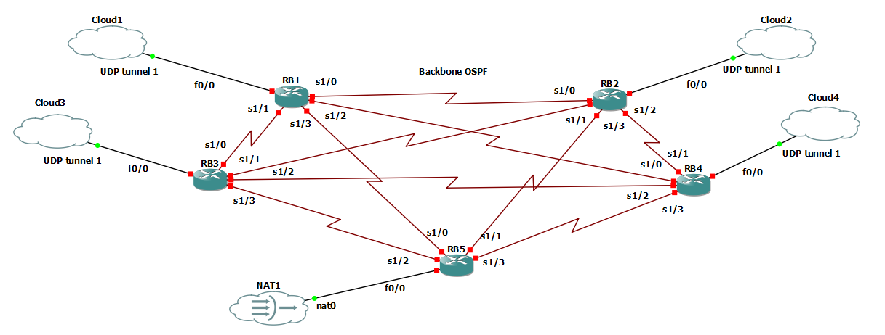

# Projet d'infrastructure réseau d'entreprise

## Présentation du projet

Ce projet consiste à concevoir et déployer un environnement réseau d'entreprise entièrement simulé, inspiré d'une infrastructure professionnelle. L'architecture repose sur un cœur backbone maillé utilisant OSPF et reliant plusieurs départements fonctionnels. Chaque département comprend des postes clients et des serveurs dédiés (Web, base de données, NFS et supervision).

Le plan d'adressage est segmenté avec VLSM afin d'utiliser efficacement les adresses IP. Un routeur principal assure le NAT pour simuler l'accès à Internet. La sécurité des échanges internes est renforcée par des tunnels VPN site-à-site entre le cœur backbone et les segments départementaux.

Cette simulation met en pratique le routage avancé, la segmentation réseau, l'intégration de services et la sécurisation d'une infrastructure d'entreprise.

## Topologie du réseau

## Ma tâche : conception et configuration du backbone

Ma partie du projet porte sur le cœur backbone, composé de cinq routeurs (RB1 à RB5). Les routeurs sont reliés en maillage complet par des liens série point-à-point. OSPF est configuré dans l'aire 0 pour diffuser les routes et assurer la connectivité entre les routeurs. Chaque routeur possède une interface Loopback utilisée comme identifiant OSPF.

Le backbone participe également à l'accès externe : RB5 assure la fonction de routeur de sortie et le NAT. Des configurations VPN IPsec site-à-site sont fournies pour protéger les échanges entre les routeurs. Les fichiers contiennent des valeurs d'exemple à remplacer avant tout déploiement réel.

## Contenu du dépôt

- `Partie Réseaux de Backbone/` : configurations de base des routeurs RB1 à RB5 (interfaces, OSPF, routes par défaut et NAT).
- `Configuration du VPN dans Backbone/` : configurations IPsec site-à-site associées aux cinq routeurs.

Le dossier `Documentation/` d'origine n'est pas inclus dans ce dépôt.

## Remarque de sécurité

Les mots de passe et clés prépartagées ont été remplacés par des valeurs fictives à renseigner. Remplacez-les par des secrets uniques et robustes avant d'utiliser ces configurations. Les réglages cryptographiques présents sont conservés à titre de simulation pédagogique et doivent être adaptés aux exigences d'un environnement réel.
